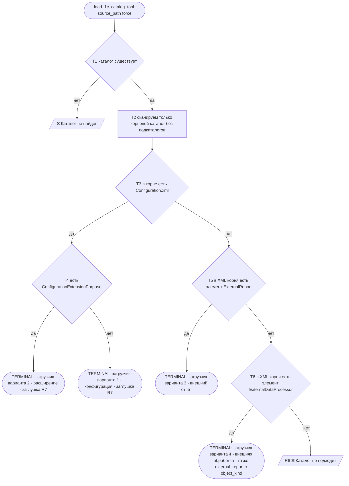
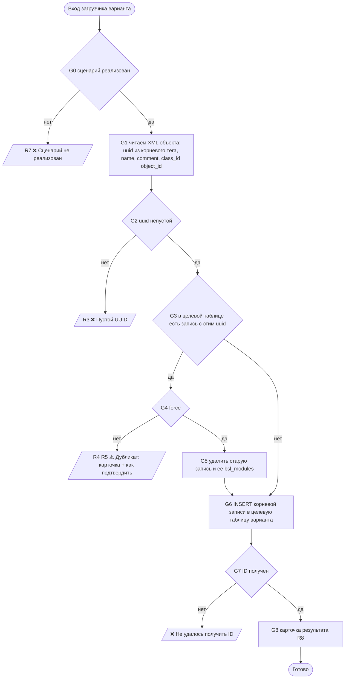
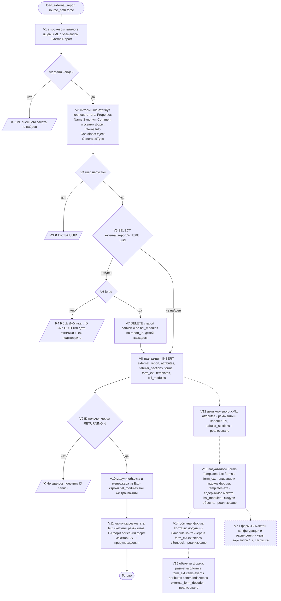

# Нормативная блок-схема поведения MCP `1c-configurations-core`

> **Статус:** утверждена 12.10.2026 как норматив поведения сервера.
> Этот файл — источник истины: код `server_configurations_core.py`, `src/config_load_router.py`,
> `LOAD_RULES_Config.md` и `.clinerules/1c-configurations-core_Rule.md` обязаны ему соответствовать.
> Любое расхождение «документ ↔ код» считается дефектом, а не особенностью реализации.

---

## 1. Контракт сервера: ровно три инструмента

| Инструмент | Сигнатура | Назначение |
|---|---|---|
| `get_load_config_rules_tool` | `()` | Шаг 0. Возвращает `LOAD_RULES_Config.md` (компактные правила + ссылка на этот документ) |
| `load_1c_catalog_tool` | `(source_path: str, force: bool = False)` | **Единая точка входа загрузки.** Сама определяет тип каталога и сама грузит. Заменяет `register_external_report_tool`, внутрь себя забирает `analyze_config_load_tool` |
| `delete_external_report_tool` | `(source_path \| uuid \| report_id, object_type)` | Удаление внешнего отчёта/обработки вместе с её BSL-модулями |

Других шагов «подготовки к загрузке» не существует: отдельного инструмента анализа нет,
анализ — это первые узлы `load_1c_catalog_tool`.

### Четыре и только четыре исхода `load_1c_catalog_tool`

| Исход | Когда | Содержание ответа |
|---|---|---|
| `✅ загружено` | объект новый | ID, UUID, имя, тип, одна строка счётчиков дочерних данных (реквизиты, табличные части, формы, описания форм, макеты, BSL-модули), предупреждения |
| `♻️ перезагружено` | дубликат + `force=True` | то же + «удалена предыдущая запись ID=…, BSL-модулей удалено: N» |
| `⚠️ нужна перезагрузка` | дубликат без `force` (в том числе тот же UUID при другой версии) | карточка существующей записи (ID, имя, UUID, тип, дата загрузки, счётчики) + как подтвердить |
| `❌ не могу загрузить` | нет каталога / каталог не подходит / пустой UUID / сценарий не реализован / не получен ID / тот же `uuid` занят строкой другого вида (узел V22, статус `kind_conflict`) | одна причина на русском + что сделать |

Текст ответов — только русский. Английское сообщение об ошибке считается дефектом.

---

## 2. Правила R1–R12

| # | Правило |
|---|---|
| **R1** | Единственный признак маршрута — наличие `Configuration.xml` **в корне** каталога. Есть → загрузчик конфигураций (различает конфигурацию и расширение по `ConfigurationExtensionPurpose`). Нет → загрузчик внешних объектов (различает отчёт и обработку по элементу `ExternalReport` / `ExternalDataProcessor` в XML файла корневого каталога) |
| **R2** | Одна точка входа. Флаг принудительной загрузки `force` — параметр этого же вызова; отдельного «анализа» нет |
| **R3** | Пустой `uuid` в XML объекта → `❌` «пустой UUID, загрузка невозможна» |
| **R4** | `uuid` уже есть в целевой таблице → `⚠️` карточка + подсказка подтверждения. Повторный вызов с `force=True` → старая запись и её BSL-модули удаляются, объект загружается заново |
| **R5** | Тот же `uuid`, но другая версия → поведение как у дубликата. Оператор вправе сразу потребовать загрузку без проверки дубликатов → `force=True` |
| **R6** | Каталог не подходит → `❌` с причиной (в корне нет ни `Configuration.xml`, ни XML внешнего отчёта/обработки) |
| **R7** | Варианты 1, 2 (конфигурация, расширение) — **заглушки**: `❌ сценарий не реализован`. Поведение предсказуемо. Вариант 4 (внешняя обработка) реализован узлом V22 и описан в разделе 6 |
| **R8** | Успех → карточка результата: ID, UUID, имя, тип, счётчики, предупреждения |
| **R9** | Разделение содержимого подкаталогов (узел V13): описание формы → `forms` + `form_ext`; **модуль формы** (`Forms/<Имя>/Ext/Form/Module.bsl`) → `form_ext.ext`, а **не** в `bsl_modules`; бинарная форма → `form_ext.ext_bin`; содержимое макета (`Templates/<Имя>/Ext/Template.xml` / `Template.bin`) → `templates.ext` / `templates.ext_bin`; модули объекта и менеджера (`Ext/*.bsl`) → `bsl_modules`. Записать модуль формы ещё и в `bsl_modules` — дефект |
| **R10** | Дочерние строки форм и макетов уникальны **в пределах родителя**: `UNIQUE (parent_uuid, uuid)` + отдельный индекс по `uuid`; модули внешнего объекта — частичный уникальный индекс `bsl_modules(parent_uuid, file_path) WHERE parent_uuid IS NOT NULL`. Глобальный `UNIQUE (uuid)` для этих таблиц — дефект (блокирует вариант «расширение») |
| **R11** | `configuration_id` (привязка к строке заголовка конфигурации, узел V20) — **данные оператора**, а не выгрузки: загрузчик не выводит её из XML, не догадывается о ней и не сбрасывает. `force=True` переносит значение на новую строку; карточка дубликата показывает привязку, карточка перезагрузки — строку о переносе. `NULL` = «привязка не заявлена», состояния «универсальный» в модели нет, и в ответах инструментов его быть не может |
| **R12** | Внешние отчёт и обработка — **одна таблица-заголовок `external_report`**. Вид строки задаёт колонка `external_report.object_kind` (значения ровно два: `external_report`, `external_processing`); её проставляет писатель заголовка, а не разбор XML, поэтому вид не может разойтись с классом, который вставляет строку. Отдельной таблицы `external_processing` в модели нет (узел V22), дочерние таблицы остаются с FK на `external_report(uuid)`. Вид обязан совпадать с `containedobject_classid` (если он непустой) и с типом self-цели обогащения (`ExternalReport` / `ExternalProcessing`) — расхождение считается дефектом и проверяется `validate_load_flow.py` |

Сканирование на этапах R1/R6 — **только файлы корневого каталога, без подкаталогов** (их там
несколько: `Configuration.xml`, `ConfigDumpInfo.xml`, XML внешнего объекта). Разбор содержимого
уже распознанного объекта (`Ext/`, `Forms/`, `Templates/`) идёт в подкаталоги, потому что это
содержимое распознанного объекта, а не поиск типа объекта.

**Фактическая структура XML выгрузки 1С (важно для T5/T6/V1):** корневый элемент файла внешнего
объекта — `<MetaDataObject xmlns="http://v8.1c.ru/8.3/MDClasses">`, а `ExternalReport` /
`ExternalDataProcessor` — его **потомок верхнего уровня**, несущий атрибут `uuid`. Поэтому
распознавание проверяет и имя корневого тега, и имена элементов верхнего уровня
(`detect_external_object_type`): поиск только по корневому тегу не нашёл бы ни одного внешнего
объекта. Проверено на `Test1_Otchet`, `Test3_Otchet_Null`, `TSD_0`.

---

## 3. Блок-схема 0 — общий ствол (терминал = выбор загрузчика)



Реализация: `src/config_load_router.py::detect_load_variant()` — узлы T1–T6;
`src/config_load_router.py::load_catalog()` — маршрутизация на загрузчики.

### Целевые таблицы вариантов

| Вариант | `variant` | Целевая таблица БД `ckb_1c_configurations` | Статус |
|---|---|---|---|
| 1. Конфигурация | `configuration` | `configurations` | ❌ заглушка (R7) |
| 2. Расширение | `extension` | `config_extensions` | ❌ заглушка (R7) |
| 3. Внешний отчёт | `external_report` | `external_report` | ✅ реализован, эталон |
| 4. Внешняя обработка | `external_processing` | `external_report` + `object_kind='external_processing'` | ✅ реализован (узел V22); отдельной таблицы `external_processing` в схеме нет |

---

## 4. Блок-схема-шаблон загрузчика (каркас всех четырёх вариант-схем)

Правила R3–R5 одинаковы для всех вариантов; различаются только целевая таблица и поля записи.



---

## 5. Блок-схема варианта 3 «внешний отчёт» — реализованный эталон



**Нумерация узлов (с 13.10.2026).** `V1–V13` — реализованный тракт внешнего отчёта.
`V14–V16` — тракт **обычных форм**: V14 (модуль из `Form.bin`) и V15 (разметка `0/form` →
`form_ext.items`/`events`/`attributes`/`commands`/`auto_command_bar`) реализованы 13.10.2026,
V16 (обратная сборка `Form.bin`) отложен.
Узел дочерних данных вариантов 1, 2, 4 обозначен **VX1** — раньше в схеме он назывался `V14`,
нумерация изменена, чтобы roadmap обычных форм не спорил с заглушкой. В текстах правил и промтов
12–13.10.2026 «V14/V15/V16» означают именно тракт обычных форм.
**V14.1** — не новый узел roadmap, а исправление дефекта внутри V13 (скалярные свойства
содержимого формы читались из несуществующего `<Properties>` в `Form.xml`): код и проверки —
в матрице «узел → код» в строке V13 и в п. 18 правил.

### Дочерние данные (узел V12)

Разбор `ChildObjects` корневого XML выполняет `src/external_meta_parser.py`; запись —
классы-писатели `src/external_table_writer.py` (`ExternalReportRowWriter`,
`AttributesRowWriter`, `TabularSectionsRowWriter`). Все три вставки выполняются
**одной транзакцией** (`src/external_db.py::transaction`): при ошибке откатывается
всё, в БД не остаётся ни основной записи, ни детей.

| Элемент `ChildObjects` | Куда сохраняется | Связь |
|---|---|---|
| `<Attribute uuid=…>` реквизит объекта | `attributes` | `parent_uuid` = uuid корневого объекта |
| `<TabularSection uuid=…>` | `tabular_sections` | `parent_uuid` = uuid корневого объекта; колонки — перечень uuid в `column_uuids` (jsonb) |
| `<Attribute uuid=…>` внутри `TabularSection/ChildObjects` (колонка ТЧ) | `attributes` — те же колонки, что у реквизитов | `parent_uuid` = uuid корневого объекта (не табличной части) |
| `<Form>`, `<Template>` из корневого XML | содержат только имя без `uuid`, поэтому используются как сверка; строки создаются по файлам регистрации `Forms/<Имя>.xml`, `Templates/<Имя>.xml` (узел V13 — следующий раздел) | `parent_uuid` = uuid корневого объекта |

Значения `xsi:nil="true"` и пустые элементы сохраняются как `NULL`; многоязычный
`Synonym` — целиком как jsonb-объект `{"ru": …, "en": …}`; `<Type>` — JSON-строка
`{"types": […], "qualifiers": {…}}` в текстовой колонке `attributes.type`.
Пустой или некорректный `uuid` у ЛЮБОГО дочернего элемента — ошибка загрузки по R3
(сообщение содержит имя элемента), загрузка прекращается до записи в БД.

### Содержимое подкаталогов `Forms/`, `Templates/`, `Ext/` (узел V13)

Разбор выполняет `src/external_subdir_parser.py::parse_external_subdirs()` (до начала
транзакции), запись — писатели `FormRowWriter`, `FormExtRowWriter`, `TemplateRowWriter`,
`BslModuleRowWriter` из `src/external_table_writer.py`. Все строки добавляются в **ту же
транзакцию**, что и записи V8/V12: ошибка разбора или вставки откатывает объект целиком.

| Что в выгрузке | Куда сохраняется | Примечание |
|---|---|---|
| `Forms/<Имя>.xml` (файл регистрации) | `forms`: `uuid` (из атрибута `uuid` этого файла), `name`, `form_type`, `synonym`, `comment`, `use_purposes`, `parent_type` | пустой или кривой `uuid` — ошибка по R3, откат |
| `Forms/<Имя>/Ext/Form.xml` | `form_ext` — одна строка на форму: `form_id` (FK → `forms(id)` ON DELETE CASCADE), `form_uuid`, `parent_uuid`, скалярные свойства (`command_bar_location`, `report_result`, `details_data`, `report_form_type`, `auto_show_state`, `custom_settings_folder`, `*_view_mode`), перечни `auto_command_bar`, `events`, `attributes`, `commands`, `items` — jsonb | скалярные свойства читаются из **корня** `Form.xml`: обёртки `<Properties>` в файле содержимого формы нет, в отличие от XML метаданных (узел V14.1, 13.10.2026 — до правки эти колонки оставались NULL); нет каталога `Ext` у формы — только предупреждение |
| `Forms/<Имя>/Ext/Form/Module.bsl` | `form_ext.ext` + `ext_size`, `ext_format='bsl'`, `ext_path`, `ext_truncated` | **в `bsl_modules` модуль формы не пишется** (R9) |
| `Forms/<Имя>/Ext/Form.bin` | `form_ext.ext_bin`, `ext_format='bin'`; **с узла V14** дополнительно `form_ext.ext` (текст модуля `0/module`), `ext_size`, `ext_path`; **с узла V15** — `form_ext.items`/`attributes`/`events`/`commands`/`auto_command_bar` из разметки `0/form` | **обычная форма** (`forms.form_type='Ordinary'`): модуль и состав элементов извлекаются из контейнера одним его распаковыванием (`_container_files` → `_store_container_form_module` + `_apply_container_form_layout` → `src/external_form_decoder.py`); скалярные свойства ordinary-формы и её заголовок в БД не пишутся (нет `Form.xml`, колонки нет) — предупреждение «скалярные свойства и заголовок ordinary-формы не сохраняются»; сбой разбора разметки — предупреждение, состав остаётся пустым, загрузка идёт дальше (см. «Обычные формы» ниже) |
| `Templates/<Имя>.xml` | `templates`: `uuid`, `name`, `template_type`, `synonym`, `comment`, `parent_type` | |
| `Templates/<Имя>/Ext/Template.xml` | `templates.ext`, `ext_root_tag` (`DataCompositionSchema` и т. п.), `ext_format='xml'`, `ext_size`, `ext_path` | |
| `Templates/<Имя>/Ext/Template.bin` | `templates.ext_bin`, `ext_format='bin'` | |
| `Ext/objectmodule.bsl`, `Ext/managermodule.bsl` | `bsl_modules`: `module_type='ObjectModule'/'ManagerModule'`, `code`, `code_size`, `truncated`, `parent_uuid`, `parent_type`, `report_id` — единая колонка связи модуля с внешним объектом любого вида (узел V22; `processing_id` удалена) | имена сверяются регистронезависимо (`MODULE_FILE_KINDS`); прочий `Ext/*.bsl` сохраняется с `module_type` = имя файла без расширения и предупреждением |

Правила узла V13 (детализация R9/R10):

- `uuid` формы и макета берётся **только** из файла регистрации; имена из корневого XML — только
  сверка: расхождение (форма есть на диске, но не объявлена в XML, или наоборот) даёт
  предупреждение, а не отказ;
- отсутствие каталогов `Forms/`, `Templates/`, `Ext/` — **не ошибка загрузки**: счётчики нулевые,
  в карточке предупреждение;
- содержимое сохраняется целиком; при превышении `MAX_TEXT_CHARS` (1 000 000 символов) оно
  обрезается, выставляется `ext_truncated` / `truncated` и предупреждение;
- `CustomSettingsFolder` вида `3:02023637-…` uuid не является и по R3 не проверяется;
- уникальность: `forms`/`templates` — `UNIQUE (parent_uuid, uuid)` плюс отдельный индекс по
  `uuid`; `form_ext` — `UNIQUE (form_id)`; `bsl_modules` — частичный уникальный индекс
  `(parent_uuid, file_path) WHERE parent_uuid IS NOT NULL` (строки конфигураций не затрагивает);
- `delete_external_report_tool` снимает `forms` (каскадом `form_ext` через FK `form_id`),
  `templates` (каскад по `parent_uuid`) и `bsl_modules` (явная чистка — FK в этой таблице
  отсутствует).
- **скалярные свойства содержимого формы (узел V14.1, 13.10.2026 — исправление дефекта п. 18
  правил):** в `Form.xml` они объявлены в его корне, поэтому разбор идёт по `FORM_CONTENT_FIELDS`
  от корневого элемента `<Form>`, а не из `<Properties>` (fallback на `<Properties>` сохранён).
  Значение вида `<CommandBarLocation>None</CommandBarLocation>` — перечисление 1С («панель команд
  не выводить»), а не `xsi:nil`: в БД пишется строка `'None'`. Пустой `report_form_type` у формы
  `Managed` с `Form.xml` — дефект разбора; проверки — раздел 19 `check_external_report_fill.sql`
  и «Test1: скалярные свойства формы разобраны из Form.xml в form_ext (V14.1)» в
  `validate_external_children.py`. У ordinary-формы (`ext_format='bin'`) эти свойства не
  заполняются: `Form.xml` для ordinary не выгружается, а отдельной колонки под скаляры из `0/form`
  нет — узел V15 их не затрагивал (решение по DDL не принято).


#### Обычные формы: что внутри `Form.bin` (исследовано 12.10.2026 на `Test2_Otchet`, форма `Отчет`)

`Form.bin` — не «чёрный ящик», а контейнер 1С (заголовок `ff ff ff 7f`) с двумя файлами внутри:

| Внутренний файл | Что это | Факт по Test2_Otchet |
|---|---|---|
| `0/form` | **текст** разметки формы в собственной раскладке 1С (`{27,` … `{14,"ПолеТабличногоДокумента",4294967295,…}`): имена элементов, команд, обработчиков событий и заголовки — открытые quoted-строки, свойства — числовые коды | 10 623 байт, 29 уникальных строк (`ПолеТабличногоДокумента`, `ДатаОтчета`, `Организация`, `ДействияФормыОтчетСформировать`, `ПередОткрытием`, «Средний возраст основных средств») |
| `0/module` | **текст модуля формы**, UTF-8 с BOM, CR+LF | 13 175 байт / 7 639 симв. / 217 строк, три процедуры (`ДействияФормыОтчетСформировать`, `Отчет … Экспорт`, `ПередОткрытием`) |

Признак обычной формы — `forms.form_type = 'Ordinary'` (берётся из `Forms/<Имя>.xml`), управляемой —
`'Managed'`; ориентироваться нужно на него, а не на сам факт наличия `Form.bin`.

Извлечение — инструментами `tools/` (`extract_form_modules.py` / `pack_form_modules.py`, v8unpack):

```
python tools/extract_form_modules.py <каталог_выгрузки> [--force]   # Form.bin → Module.bsl рядом
python tools/pack_form_modules.py <каталог_выгрузки>                # Module.bsl → обратно в Form.bin
```

- нужен `pip install v8unpack` (зависимость описана в `tools/requirements.txt` — `v8unpack>=1.2.0`;
  в корне проекта `requirements.txt` нет) и вызов **с `deflate=False`**:
  `Form.bin` из XML-выгрузки не сжат; CLI `python -m v8unpack -E Form.bin …` к нему неприменим —
  падает `invalid block type`, так как ждёт сжатые контейнеры (`.epf`, `.cf`);
- загрузчик V13 ищет модуль формы только по пути `Forms/<Имя>/Ext/Form/Module.bsl`, поэтому файл
  `Forms/<Имя>/Ext/Module.bsl`, который создаёт инструмент, **не замечает** (проверено офлайн на
  трёх раскладках: оригинал / `Ext/Module.bsl` / `Ext/Form/Module.bsl` — модуль попадает в `ext`
  только в третьем случае). С узла V14 это больше не слепая зона: модуль берётся из самого
  `Form.bin`, размещать рядом `Module.bsl` для загрузки не нужно;
- содержимое полностью восстанавливается из БД: `form_ext.ext_bin` байт-в-байт равен файлу
  (`sha256 bb6d5fbf…`), распаковка этого `bytea` даёт модуль, идентичный файловому
  (`sha256 5f1b80af…`) — исходные файлы выгрузки для этого не нужны; получить его можно командой
  `python validate_form_bin_decode.py --uuid <uuid> --form Отчет --out _v14_form_module.bsl`
  (проверено 12.10.2026: модуль 13 175 байт / 217 строк сохранён в `_v14_form_module.bsl` и
  `_v14_form_module.from_db.bsl`, хэши совпали);
- round-trip extract→pack сохраняет `0/form` и `0/module` точно, меняется только служебная
  раскладка контейнера (из 24 549 байт различаются 23 717) — бинарный diff в git неизбежен,
  это свойство формата, а не дефект инструментов;
- дефект инструментов (исправлен 12.10.2026 в `tools/extract_form_modules.py`): запись текста с
  `newline='\r\n'` поверх уже CRLF-текста удваивала CR — `Module.bsl` 13 392 байта вместо
  13 175, после `pack` в модуле формы появлялось 217 отдельных CR (434 «строк» вместо 217).
  После правки извлечение байт-в-байт, `pack` — 13 175 → 13 175, `0/form` не меняется.

#### Реализовано (узел V14, 13.10.2026): модуль обычной формы попадает в `form_ext.ext`

При `ext_format='bin'` загрузчик берёт `0/module` из **уже сохранённого** `form_ext.ext_bin`
(файлы выгрузки не нужны) и пишет текст в `form_ext.ext`. Реализация:
`src/external_subdir_parser.py::_container_files` (распаковка байтов контейнера тем же
`v8unpack.container_reader`, что и `tools/extract_form_modules.py`; импорт опциональный) и
`_store_container_form_module` (текст `0/module` в контракт `form_ext` до вставки, вызов из
`_read_form`). Предупреждение для обычной формы переформулировано: оно говорит,
что модуль извлечён, а элементы формы — нет, и больше не ссылается на несуществующий
`Forms/<Имя>/Ext/Form/Module.bsl`.

**Политика байт (зафиксирована проверкой).** Текст модуля нормализуется так же, как модули
управляемых форм: снимается UTF-8 BOM (кодировка `utf-8-sig`), снимается обрамляющая пустота
(`TableRowWriter._adapt` для вида колонки `text`: `str(value).strip()`, пустая строка → `NULL`).
Поэтому `octet_length(ext)` **не обязан** равняться размеру
`0/module` из контейнера: у формы `Отчет` из `Test2_Otchet` было 13 175 → 13 124 байта (−41 =
3 BOM + 38 завершающих CR/LF). Инварианты узла V14:

| Инвариант | Значение |
|---|---|
| `form_ext.ext` | непустой текст модуля; внутренний текст и переводы строк совпадают байт-в-байт после снятия BOM и обрамляющей пустоты |
| `form_ext.ext_size` | `octet_length(ext_bin)` — размер контейнера, а не текста (значение задаёт парсер `_read_form`: `ext_size = len(ext_bin)`, писатель переносит его в колонку) |
| `form_ext.ext_truncated` | `false` |
| `form_ext.ext_format` / `ext_path` | `bin` / путь к `Form.bin` (источник текста — контейнер) |
| `bsl_modules` | модуль формы **не дублируется** (R9) |

**Переводы строк в `ext` зависят от источника:** `Module.bsl` читается через `Path.read_text()` →
CRLF превращаются в LF; модуль из `Form.bin` декодируется из байтов → CRLF сохраняются. Разница
осознанная (текст не переписывается), но SQL-поиск по строкам обязан это учитывать:
`split_part`/`regexp_split_to_array` — по `[[:space:]]+` или `E'\\r?\\n'`, а не по `chr(10)`.

**v8unpack — опциональная зависимость (решение зафиксировано узлом V15).** При её отсутствии
поведение остаётся как в V13 (`ext` пуст, `ext_bin` заполнен, состав формы не разложен) и в карточке
появляется предупреждение «v8unpack не установлен…». Рантайм-зависимость core-сервера не вводится,
в корневой `requirements.txt` пакет не переносится — он остаётся только в `tools/requirements.txt`
(`v8unpack>=1.2.0`). Тот же отказ с той же деградацией — при неподдерживаемой версии разметки или
её повреждении.

**Проверка:** `python validate_form_bin_decode.py --file <Form.bin> --uuid <uuid> --form Отчет`
(код возврата 0, секции «ПРОВЕРКА V14» и «ПРОВЕРКА V15») — сверяет `ext` из БД с модулем контейнера
по байтам после нормализации, проверяет инварианты таблицы выше, сверяет офлайн-разбор `0/form` с
содержимым `form_ext.items`/`attributes`/`events`/`commands` и строками витрин и проверяет round-trip
разметки. SQL-эквивалент — разделы 15 и 17–20 `check_external_report_fill.sql`,
поиск по составу — `check_external_report_search.sql` (ПОИСК 12–16), инвентарь —
`check_external_report_inventory.sql`.

#### Реализовано (узел V15, 13.10.2026): разметка `0/form` разложена в те же колонки `form_ext`

Цель узла — чтобы SQL-анализ был единым для `Ordinary` и `Managed`: новые колонки не вводились,
заполняются те же `form_ext.items` / `attributes` / `events` / `commands` / `auto_command_bar`.

Реализация:

| Файл | Что делает |
|---|---|
| `src/external_form_decoder.py` (новый) | `decode_layout(layout_bytes, form_name, form_uuid)` — обёртка над `v8unpack.MetaDataObject.Form.FormElements26/27` (класс выбирается по версии из первого элемента `0/form`; у эталонной выгрузки — `27`), контракт: `success`/`reason`, `columns` (`items`, `attributes`, `events`, `commands`, `auto_command_bar`), `caption`, `layout_version`, `counts`, `warnings`. Исключений не бросает: любой сбой → `success=False` с причиной. Вспомогательные `_Stub` (атрибуты, которые `FormElements27` читает и пишет: `options`, `props`, `elements_tree`, `elements_data`, `props_index`, `params`, `commands`, `header`), `_as_jsonable` (снимает `bytes`/`set`/`dict_keys`, остающееся отдаёт строкой), `_brief_raw` (краткое описание `raw` вместо полного `elem.json`) |
| `src/external_subdir_parser.py` | `_apply_container_form_layout` — вызов декодера из `_read_form` при `ext_format='bin'`; контейнер распакуется **один раз на форму** (`_container_files`) и переиспользуется для `0/module` (V14) и `0/form` (V15): `_store_container_form_module` принимает уже распакованный контейнер. Контракт `form_ext` дополняется **после** установки скаляров V14.1 — иначе `items=None` затёр бы `[]` из `Form.xml` |
| карточка результата | отдельная строка «Состав формы … разложен из 0/form (версия разметки N): items …, attributes …, events …, commands …»; при сбое — предупреждение с причиной и «состав формы не разложен», загрузка продолжается |

Ключи `items` для ordinary: `path` (например `Страница1/Организация`), `name`, `page`, `type`
(имена из `FormItemTypes`: `CommandPanel`, `Field`, `Label`, `ListField`, `Page`, `TableField`),
а также `data_source` (атрибут формы, к которому привязан элемент) и `captions` — только при наличии;
служебные `id` и краткое описание `raw` сохраняются, полный `elem.json` (63 КБ против 10.6 КБ
разметки) — нет: источник истины `form_ext.ext_bin`, из него `0/form` воспроизводится побайтово.

Эталон `Test2_Otchet` (форма `Отчет`): `items` 10 (страница + 9 элементов), `attributes` 4
(`Организация`, `ДатаОтчета`, `ВнешнийОтчетОбъект`, `ПолеСписка1`), `events` 1 (`ПередОткрытием`),
`commands` 1 (`ДействияФормыОтчетСформировать`), `auto_command_bar.name` = `ДействияФормы`;
через `v_form_elements` — 10 элементов, из них 10 с типом, 3 с источником данных, 4 с подписью;
через `v_form_events` — 1 событие. Витрины нормализуют ключи Managed (`kind`/`datapath`/`title`) и
Ordinary (`type`/`data_source`/`captions`) через `COALESCE`, поэтому запросы к ним не менялись.

**Что узлом V15 не закрывается:** скалярные свойства ordinary-формы и её заголовок — для ordinary
`Form.xml` не выгружается, а отдельной колонки под эти значения нет (решение DDL — за рамками узла;
декодер заголовок читает и отдаёт в контракте `caption`, но в БД он не пишется). Обратная сборка
`Form.bin` из `items`/`ext` — узел V16.

**Проверки узла V15:** `validate_external_children.py` (наполнение, витрины, «без `v8unpack`
загрузка продолжается: `ext_bin` сохранён, состав пустой, предупреждение с причиной»,
«после восстановления `v8unpack` тот же каталог разложен полностью» — детерминированность,
`force=True` без дублей `form_ext`); `validate_form_bin_decode.py` (секция V15 + round-trip через
`tools/decode_form_layout.check_round_trip`); офлайн-разбор подкаталогов —
`python C:\TMP\_t2_probe_subdirs.py`; разбор одной разметки — `python tools/decode_form_layout.py`.

### Поля записи `external_report` (узел V8)

| Колонка | Источник в XML |
|---|---|
| `uuid` | атрибут `uuid` корневого тега `<ExternalReport uuid="…">` |
| `name` | `Properties/Name`, fallback — имя файла XML |
| `synonym` | `Properties/Synonym` → jsonb-объект по всем `<v8:item>` (`{"ru": …, "en": …}`), при отсутствии — `'{}'::jsonb` |
| `comment` | `Properties/Comment` |
| `containedobject_classid`, `containedobject_objectid` | `InternalInfo/ContainedObject/{ClassId,ObjectId}` (элементы `InternalInfo` выгружаются с префиксом `xr:`, поиск по локальным именам тегов) |
| `generatedtype_name`, `generatedtype_category`, `generatedtype_typeid`, `generatedtype_valueid` | атрибуты и дочерние элементы `InternalInfo/GeneratedType` |
| `default_form`, `auxiliary_form`, `default_settings_form`, `auxiliary_settings_form`, `default_variant_form`, `variants_storage`, `settings_storage`, `main_data_composition_schema` | одноимённые `Properties/*`, берётся часть после точки |
| `configuration_id` (узлы V20, V20.1) | **из XML не берётся вовсе**: в выгрузке внешнего объекта ссылки на конфигурацию нет (`containedobject_*` — идентификаторы класса/объекта метаданных, к конфигурации отношения не имеют). Значение — id строки заголовка `configurations.id`, заявленный оператором (`set_object_configuration_tool` в enrichment-MCP). Внешнего ключа в схеме нет (узел V20.1, 14.10.2026): `configurations` — справочная таблица, ключ блокировал бы ведение заголовков; индекс `idx_external_report_configuration_id` сохранён ради обратного поиска. Пустое значение остаётся `NULL` = «привязка не заявлена»; id без строки заголовка = «битая ссылка, требуется перепривязка» (состояние считается JOIN'ом при чтении); при `force=True` прежнее значение переносится (правило R11) |

В таблице `external_report` **нет колонки `version`**, поэтому сравнение версий на узле V5 недоступно:
случай «тот же UUID, другая версия» (R5) обрабатывается как обычный дубликат.

### Модули внешнего объекта (узлы V10 → V13)

- Разбирается каталог `Ext/` объекта: `objectmodule.bsl` → `module_type='ObjectModule'`,
  `managermodule.bsl` → `module_type='ManagerModule'`; прочие `*.bsl` сохраняются с
  `module_type` = имя файла без расширения и предупреждением. Модули ФОРМ в `bsl_modules`
  **не пишутся** — их содержимое в `form_ext.ext` (R9).
- Строки пишет `BslModuleRowWriter` (`src/external_table_writer.py`) в **той же транзакции**,
  что и `external_report`, `attributes`, `tabular_sections`, `forms`, `form_ext`, `templates`:
  частичной индексации больше нет — при ошибке откатывается всё. Наследованный блок индексации
  через `psql.exe` (`_run_psql`) из загрузчика удалён; `_run_psql` остался только в
  `delete_external_object()` для подсчёта и удаления строк.
- Колонки: `module_name`, `file_path` (путь относительно каталога выгрузки), `code`,
  `code_size`, `truncated`, `module_type`, `object_type`, `object_name`, `report_id`,
  `parent_uuid`, `parent_type`.
- `parent_uuid` = uuid внешнего объекта, `parent_type` = `external_report`. **FK на
  `external_report(id)` в БД отсутствует**, поэтому при удалении объекта модули снимаются явно
  (`delete_external_object`), иначе остаются «сироты».
- Порог кода — `MAX_TEXT_CHARS` (1 000 000 символов): при превышении сохраняется часть кода,
  `truncated = true` + предупреждение в карточке.
- Уникальность — частичный индекс `bsl_modules(parent_uuid, file_path) WHERE parent_uuid IS NOT NULL`
  (R10): повторная загрузка без `force` дублей не создаёт, `force=True` сначала удаляет старую
  запись и её модули.

---

## 6. Варианты 1, 2 — заглушки (R7); вариант 4 реализован (узел V22)

Точка входа доходит до узла G0 и возвращает `❌` с одинаковым текстом:

```text
❌ Не могу загрузить: сценарий «конфигурация» ещё не реализован (заглушка).
   Каталог определён: Configuration.xml в корне каталога.
   Что делать сейчас: объект в БД не записан, загрузку продолжить нечем.
```

Осознанное следствие R1: каталог `TSD_R` содержит и расширение, и файл внешней обработки
(`ТСД_1С_XXI_Век2.xml`) — по правилу R1 он относится к варианту 2, и внешняя обработка из него
сейчас недоступна. Это зафиксированное поведение, а не ошибка.

### Вариант 4 «внешняя обработка» — реализован узлом V22 (14.10.2026)

Заголовок обработки — строка **той же** таблицы `external_report`, вид различает колонка
`object_kind` (правило R12). Отличия от варианта 3 — только в распознавании, подтверждении вида
и записи заголовка:

| Аспект | Вариант 3 (отчёт) | Вариант 4 (обработка) |
|---|---|---|
| Узел распознавания | T5, элемент `ExternalReport` | T6, элемент `ExternalDataProcessor` |
| Писатель заголовка | `ExternalReportRowWriter`, `object_kind='external_report'` | `ExternalProcessingRowWriter`, пишет в `external_report`, `object_kind='external_processing'` (значение — константа класса `CONSTANTS`, а не поле разбора) |
| Подтверждение вида по ClassId | `e41aff26-25cf-4bb6-b6c1-3f478a75f374` | `c3831ec8-d8d5-4f93-8a22-f9bfae07327f` |
| Пустой `<xr:ClassId>` | предупреждение, вид остаётся заявленным корневым элементом | то же |
| Чужой ClassId | отказ: вид и выгрузка описывают разные классы метаданных | то же |
| Дочерние данные | `attributes`, `tabular_sections`, `forms`, `form_ext`, `templates`, `bsl_modules` по `parent_uuid` | те же таблицы, `parent_type='external_processing'` |
| Обогащение (V17) | self-цель `ExternalReport` | self-цель `ExternalProcessing`, `parent_type='external_processing'`, карточка называет объект обработкой |
| Удаление | `delete_external_report_tool` по `source_path` / `uuid` / `report_id` | тот же инструмент, `object_type='external_processing'` (различает только ссылки `bsl_modules`) |

Что узлом V22 **не** закрывается: имена `bsl_modules.report_id` и параметра `report_id`
инструмента удаления относятся к общей таблице-заголовку (переименование — узел V23);
обработка, объявленная внутри каталога расширения (`TSD_R`), по-прежнему недоступна из-за R1;
автоматической классификации «универсальный / привязанный» нет (правило R11).

Что нужно для реализации оставшихся вариантов 1–2 (будущие вариант-схемы):

| Вариант | Минимальный объём реализации |
|---|---|
| 1 `configuration` | таблица `configurations` есть (`name, synonym, version, vendor_name, uuid, compatibility_mode, …`); нужны: чтение `Configuration.xml` (UUID берётся из атрибута `uuid` корневого тега `<Configuration uuid="…">`, а не из `<GUID>`), регистрация, индексация объектов из `ConfigDumpInfo.xml`, цикл по `status` |
| 2 `extension` | таблица `config_extensions` есть, но `configuration_id NOT NULL` → нужен узел «базовая конфигурация не найдена в БД» (в `TSD_R` есть `<ConfigurationExtensionPurpose>AddOn`, `<AddTo>` отсутствует) |

---

## 7. Матрица «узел → код»

| Узел | Файл / функция | Статус |
|---|---|---|
| Точка входа | `server_configurations_core.py::load_1c_catalog_tool` | ✅ реализован (замена `register_external_report_tool`) |
| T1–T6 | `src/config_load_router.py::detect_load_variant` | ✅ только корневой каталог; распознавание через `detect_external_object_type` (корневой тег и элементы верхнего уровня) |
| Маршрутизация, G0 | `src/config_load_router.py::load_catalog` | ✅ реализован |
| G0 для вариантов 1, 2 | `src/config_load_router.py::load_configuration_stub` и др. | ✅ заглушки с явным `❌`; G0 варианта 4 проходит дальше (узел V22) |
| V1 | `src/external_report_loader.py::detect_external_object_type` + `_find_root_object_xml` | ✅ поиск только в корне; распознаётся и корневой тег, и элементы верхнего уровня (`MetaDataObject` → `ExternalReport`) |
| V3 | `src/external_meta_parser.py::parse_external_meta` (чтение `Properties`, `InternalInfo`, `_local`/`_child`/`_multi_text`) | ✅ вызывается из `register_external_report()` |
| V4 (R3) | `src/external_meta_parser.py::_check_uuid` | ✅ проверяется uuid и корневого, и каждого дочернего элемента |
| V5, V6 | `find_external_object()`, параметр `force` | ✅ (`replace` оставлен как устаревший псевдоним) |
| V7 | `delete_external_object()` | ✅ (BSL чистится явно, дети — каскадом по FK `parent_uuid`) |
| V8 | `src/external_table_writer.py::ExternalReportRowWriter` + `src/external_db.py::transaction` | ✅ psycopg2, параметры запроса, одна транзакция на объект |
| V9 | `TableRowWriter.insert()` (`INSERT … RETURNING id`) | ✅ фолбэки `SELECT по uuid` и `MAX(id)` больше не нужны: ID возвращается тем же оператором вставки |
| V10 | `src/external_table_writer.py::BslModuleRowWriter` (вызов из `register_external_report()`) | ✅ модули `Ext/` пишутся в той же транзакции; блок индексации через `psql.exe` удалён |
| V11 | `src/config_load_router.py::format_load_result` | ✅ единый формат 4 исходов + одна строка счётчиков дочерних данных (реквизиты, ТЧ, формы, описания форм, макеты, BSL) |
| V12 | `src/external_meta_parser.py` + `src/external_table_writer.py` (`AttributesRowWriter`, `TabularSectionsRowWriter`) | ✅ реквизиты и колонки ТЧ в `attributes`, табличные части в `tabular_sections`. Черновой `_parse_child_objects()` удалён из вызова, функция в файле сохранена до удаления |
| V13 | `src/external_subdir_parser.py::parse_external_subdirs` + писатели `FormRowWriter`, `FormExtRowWriter`, `TemplateRowWriter`, `BslModuleRowWriter`; схема — `migrate_v13_forms_templates_bsl.sql`, источник DDL — `src/generate_ddl.py` | ✅ `forms` + `form_ext` (описание формы и её модуль), `templates.ext`/`ext_bin` (содержимое макета), `bsl_modules` с `parent_uuid`/`module_type`. Уникальность форм/макетов — в пределах родителя. **V14.1 (13.10.2026):** скалярные свойства формы читаются из корня `Form.xml` по `FORM_CONTENT_FIELDS` (обёртки `<Properties>` в этом файле нет) — до правки колонки `command_bar_location`/`report_result`/`details_data`/`report_form_type`/`auto_show_state`/`custom_settings_folder`/`*_view_mode` оставались NULL (дефект п. 18 правил); проверка — раздел 19 `check_external_report_fill.sql` и `validate_external_children.py` |
| V14 | `src/external_subdir_parser.py::_container_files` + `_store_container_form_module` (вызов из `_read_form`); проверка — `validate_form_bin_decode.py::verify_v14` | ✅ модуль `0/module` из `ext_bin` пишется в `form_ext.ext` (BOM и обрамляющая пустота снимаются, `ext_size = octet_length(ext_bin)`); v8unpack опционален, без неё — поведение V13 + предупреждение. Витрины анализа — `migrate_v14_form_analysis_views.sql` (`v_form_elements`, `v_form_events`) |
| V15 | `src/external_form_decoder.py::decode_layout` (обёртка над `v8unpack.MetaDataObject.Form.FormElements26/27`) + вызов `src/external_subdir_parser.py::_apply_container_form_layout` из `_read_form`; офлайн-разбор и round-trip — `tools/decode_form_layout.py`; проверки — `validate_external_children.py`, `validate_form_bin_decode.py::verify_v15`, разделы 17–18 `check_external_report_fill.sql`, разделы 27–31 `check_external_report_search.sql`, разделы 7 и 10–13 `check_external_report_inventory.sql` | ✅ `0/form` разложен в **те же** колонки `form_ext`, что и `Form.xml` у `Managed`: `items` (`path`/`name`/`type`/`page`/`data_source`/`captions`), `attributes`, `events`, `commands`, `auto_command_bar`. Эталон `Test2_Otchet`: items 10, attributes 4, events 1, commands 1, `auto_command_bar.name=ДействияФормы`; через витрины 10/10/3/4 и 1 событие. Контейнер распакуется один раз на форму и переиспользуется для `0/module` и `0/form`. v8unpack остаётся **опциональной**: без неё (или при неподдерживаемой/битой разметке) — предупреждение, состав пустой, загрузка идёт дальше. Полный `elem.json` в БД не пишется (источник истины — `ext_bin`). **Не закрывается узлом:** скалярные свойства ordinary-формы и её заголовок (колонок нет, DDL не менялся) |
| VX1 | заглушки `src/config_load_router.py` (варианты 1, 2) | ❌ формы и макеты конфигурации/расширения; упирается в полиморфизм схемы (п. 13 правил). Вариант 4 снят узлом V22 |
| V17 (обогат) | `src/enrichment_generator.py::generate_for_object` + писатели `ConfigAliasRowWriter`, `ConfigSnippetRowWriter`, `ConfigSnippetDependencyRowWriter`, `ConfigCrossReferenceRowWriter`; схема — `src/ddl_enrichment.sql` (шаг 1b) / `migrate_v17_enrichment.sql`; очистка при удалении — `src/external_report_loader.py::delete_external_object` | ✅ обогащение внешнего отчёта (алиасы, авто-сниппеты, зависимости, счётчики) вне транзакции загрузки; контракт enrichment-MCP — 16 инструментов, норматив — `docs/CONFIGURATIONS_ENRICHMENT_PLAN.md` |
| V17.7 (карточка) | `src/enrichment_generator.py::describe_object` + `_describe_sections` + `type_brief`; вывод — `config_enrichment_stats_tool(uuid=…, card=True)`; проверка — `validate_enrichment_flow.py::phase_object_card` | ✅ только чтение, одна транзакция: свойства и назначение отчёта, реквизиты объекта (колонки ТЧ отсечены `NOT EXISTS` по `column_uuids`) с читаемым типом, ТЧ с числом колонок, формы + состав через `v_form_elements`/`v_form_events`, макеты с `ext_root_tag`, модули, перечень сниппетов. Порядок реквизитов — по `attributes.id` (колонки позиции нет) |
| V20 (привязка к конфигурации) | схема: `src/generate_ddl.py` (колонка + индекс) и `create_1c_configurations_db.sql` / `migrate_v20_configuration_link.sql`; рантайм: `ExternalReportRowWriter`, `find_external_object`, `register_external_report` (перенос при `force=True`), `config_load_router` (карточки дубликата и перезагрузки); карточка — `describe_object` + `_card_identity_lines`; проверка — `tools/check_v20_config_link.py` | ✅ `external_report.configuration_id` = id строки заголовка `configurations.id`, **заявляется только оператором**, из выгрузки не выводится (правило R11); NULL = «привязка не заявлена», состояния «универсальный» нет; `force=True` значение переносит. Автоматическая классификация — вне узла (раздел 12 `docs/CONFIGURATIONS_ENRICHMENT_PLAN.md`) |
| V20.1 (снять FK, битую ссылку сделать видимой) | схема: `src/generate_ddl.py` + `src/ddl_external_report.sql` и `create_1c_configurations_db.sql` (DO-блоки FK удалены из обоих шагов), `migrate_v20_configuration_link.sql` (FK больше не создаёт) + `migrate_v21_drop_configuration_fk.sql` (`DROP CONSTRAINT IF EXISTS`); рантайм: `src/enrichment_generator.py::{_binding_state_row, set_object_configuration, describe_object, generate_enrichment}`, `src/enrichment_snippets.py::enrichment_stats`, `server_configurations_enrichment.py::{set_object_configuration_tool, _binding_lines, _card_identity_lines}`; SQL — раздел `15f` `check_external_report_inventory.sql`; проверки — `tools/check_v20_config_link.py` (34), фаза `phase_configuration_link` в `validate_enrichment_flow.py` (122 проверки) | ✅ внешний ключ `external_report_configuration_fkey` снят: `configurations` — справочная таблица, нужная при проверке данных отчёта, ключ блокировал бы ведение заголовков. Колонка и индекс `idx_external_report_configuration_id` сохранены. Целостность записи проверяет `set_object_configuration_tool` (несуществующий id отклоняется, битой ссылки не создаёт; `None` — снять), при чтении состояние считается JOIN'ом и называется прямо в трёх местах: карточка (`configuration_state`), сводка без uuid (обратный перечень + счётчики `configuration_not_declared`/`bound`/`dangling`), генерация (предупреждение, состав строится как обычно). Контракт enrichment-MCP: 17 → 18 инструментов |
| V22 (единый заголовок внешнего объекта, `object_kind`) | схема: `src/generate_ddl.py` → `src/ddl_external_report.sql` (колонка `object_kind` + CHECK `external_report_object_kind_check`, витрина `v_config_enrichment` с колонкой вида), `create_1c_configurations_db.sql` (таблица `external_processing` больше не создаётся), для живых БД — `migrate_v22_object_kind.sql`; запись: `src/external_table_writer.py::{TableRowWriter.CONSTANTS, ExternalReportRowWriter, ExternalProcessingRowWriter}`; разбор: `src/external_meta_parser.py::{OBJECT_CLASS_IDS, OBJECT_KIND_TITLES, _check_object_kind}`; маршрутизация и карточки: `src/config_load_router.py::{load_catalog, _existing_card, format_load_result}` (исход `kind_conflict`); удаление: `src/external_report_loader.py::{find_external_object, register_external_report, delete_external_object}`; обогащение: `src/enrichment_generator.py::{object_kind_of, describe_object, _describe_sections}`, `src/enrichment_aliases.py`, `src/enrichment_snippets.py::enrichment_stats` (разбивка по видам) | ✅ внешняя обработка грузится в `external_report` с `object_kind='external_processing'` (правило R12): вид заявляет класс писателя, пустой `<xr:ClassId>` — предупреждение, чужой ClassId — отказ; таблица `external_processing` и колонка `bsl_modules.processing_id` удалены; один `uuid` под двумя видами — отказ (`kind_conflict`), а не вторая строка. Проверки: `validate_load_flow.py` (кейс `TSD_0`, инварианты вида по всей БД), `_v13_mcp_layer.py` (тот же путь через обёртки MCP-инструментов: видовая строка в карточке, `parent_type` детей, удаление с `object_type`), `_v22_probe.py`, `_v22_enrich_probe.py`, `_v22_invariants.sql` и раздел `15g` в `check_external_report_inventory.sql` (инварианты вида на любом состоянии базы), `_cmp_ddl.py` (273 колонки, 56 индексов, 30 ограничений, 4 витрины — расхождений нет) |

### Предупреждение: core-сервер не перегенерировать

`generate_servers.py` вырезает тела инструментов из устаревшего монолита `server_configurations.py`
и подставляет фиксированный заголовок без импортов `src/`. Контрактных инструментов в монолите нет,
список `CORE_TOOLS` генератора не совпадает с реальным набором core-сервера. Случайный запуск
`python generate_servers.py` удалит `get_load_config_rules_tool`, `load_1c_catalog_tool` и
`delete_external_report_tool` из рабочего файла. **`server_configurations_core.py` ведётся вручную,
генератор для него не используется.**

---

## 8. Вне контракта (не участвуют в загрузке)

**Состояние 14.10.2026: инструменты вне контракта из core-MCP удалены** (дефект п. 11 правил
закрыт). В `server_configurations_core.py` остались ровно три контрактовых инструмента —
`get_load_config_rules_tool`, `load_1c_catalog_tool`, `delete_external_report_tool`; это
проверяется AST-сверкой `python tools/check_mcp_tool_wiring.py` (ошибки «вне EXPECTED_TOOLS»
были бы видны в rc).

Удалены: `analyze_config_load_tool` (анализ — внутренняя `detect_load_variant`),
`list_configurations_tool`, `get_configuration_tool`, `find_config_by_name_uuid_tool`,
`search_config_objects_tool`, `list_config_objects_tool`, `get_object_structure_tool`,
`count_objects_by_config_tool`, `delete_objects_by_config_tool`, `update_configuration_status_tool`,
`delete_config_tool`, `batch_index_from_dump_tool`, `list_bsl_modules_tool`,
`get_bsl_module_code_tool`, `read_config_file_tool`, `search_bsl_code_tool`, `get_enum_values_tool`,
устаревший псевдоним `register_external_report_tool`. Вместе с ними удалён мёртвый код, который
не мог работать: `src/config_tools.py`, `src/config_aliases.py`, `src/config_snippets_manager.py`,
`src/config_tools_1c_configurations.py` (обращались к БД `configurations`, которой на сервере нет)
и `generate_servers.py` (генератор, теряющий инструменты контракта).

Чем заменены задачи удалённых инструментов:

| Задача | Чем пользоваться |
|---|---|
| посмотреть список/состояние загруженных внешних объектов | SQL по `external_report` (счётчики детей — запрос из раздела 10) или `config_enrichment_stats_tool` без `uuid` |
| найти объект или его реквизит/форму/макет | `search_config_aliases_tool` / `resolve_config_alias_tool` / `search_config_snippets_tool` (enrichment-MCP) либо SQL-сверки `check_external_report_search.sql` |
| получить структуру объекта и его свойства | `config_enrichment_stats_tool(uuid=…, card=True)` (карточка V17.7) |
| получить код модуля | `get_config_snippet_tool` (авто-сниппет модуля) или SQL по `bsl_modules.code` |
| удалить объект | `delete_external_report_tool` (контрактный инструмент) |

---

## 9. Отложено

1. **Варианты 1, 2** — реализация вместо заглушек (вариант 4 снят узлом V22, см. раздел 6).
   Формы и макеты конфигурации/расширения
   (узел **VX1**, раньше назывался V14) упираются в полиморфизм схемы: `forms.parent_uuid`/`templates.parent_uuid` имеют
   FK только на `external_report(uuid)`, а `attributes`/`tabular_sections` — по-прежнему
   глобальный `UNIQUE (uuid)`.
2. **Каталоги без UUID** — сейчас это ошибка (R3); поведение для частичных выгрузок пересматривается,
   когда такая выгрузка появится реально.
3. **Порог производительности** вариантов 1–2: корневое сканирование удешевляет определение типа,
   но не индексацию тысяч объектов в подкаталогах `Catalogs/`, `Documents/` — вопрос объёма решается
   вместе с вариант-схемой конфигурации.
4. **Формы и макеты, объявленные в корневом XML, но без каталога содержимого**: строки не создаются
   (uuid берётся только из `Forms/<Имя>.xml` / `Templates/<Имя>.xml`), выдаётся предупреждение.
   Поведение для «сиротских» каталогов `Forms/` без объявления в XML — только предупреждение.
5. **Модуль обычной формы** (`forms.form_type='Ordinary'`, содержимое — `Form.bin`) — **снято узлом
   V14 (13.10.2026)**: при `ext_format='bin'` модуль `0/module` берётся из уже сохранённого
   `form_ext.ext_bin` и пишется в `form_ext.ext`, предупреждение говорит про `Form.bin`, а не про
   отсутствующий `Ext/Form/Module.bsl`. v8unpack остаётся **опциональной** зависимостью: без неё
   сохраняется поведение V13 и выдаётся предупреждение. Модуль формы в `bsl_modules` не дублируется.
6. **Элементы обычной формы (узел V15)** — **снято узлом V15 (13.10.2026)**: `0/form` разложен
   декодером `src/external_form_decoder.py::decode_layout` в те же колонки `form_ext`, что и
   `Form.xml` у `Managed` (`items`/`attributes`/`events`/`commands`/`auto_command_bar`), вызов —
   `src/external_subdir_parser.py::_apply_container_form_layout` в той же транзакции. Полный
   `elem.json` v8unpack (63 КБ против 10.6 КБ разметки) в БД не пишется — источник истины `ext_bin`,
   из него layout воспроизводится байт-в-байт. Деградация реализована: нет v8unpack /
   неподдерживаемая версия элементов → состав остаётся пустым, в карточке предупреждение, загрузка
   не падает (проверено офлайн). Осталось за рамками: скалярные свойства ordinary-формы и её
   заголовок — колонок под них нет, DDL узла V15 не менялся.
7. **Обратная сборка `Form.bin` (узел V16)** — `items`+`ext` (+ raw-шаблон) → `0/form`+`0/module` →
   `container build` → `Form.bin`, с побайтовой самопроверкой «не меняли → байт-в-байт». Фундамент
   генерации внешних отчётов/обработок с нуля. Для новых разработок предпочтительны управляемые
   формы: они выгружаются как `Form.xml`, и тракт V13 уже раскладывает их полностью.
8. **Имена `bsl_modules.report_id` и параметра `report_id` инструмента удаления (узел V23)** — с
   узла V22 обе строки (отчёт и обработка) лежат в одной таблице-заголовке, поэтому имя `report_*`
   стало историческим. Переименование — отдельный узел: оно затрагивает SQL-сверки,
   `check_external_report_*.sql`, инструмент `delete_external_report_tool`, витрины и правила,
   а данных для переноса нет (колонка `processing_id` уже удалена как неиспользуемая).

Реализовано (узлы V14+V15, 13.10.2026): модуль обычной формы в `form_ext.ext` и её состав элементов
в `form_ext.items`/`attributes`/`events`/`commands`/`auto_command_bar` (см. раздел
«Обычные формы» → «Реализовано (узел V14)» и «Реализовано (узел V15)»); витрины анализа состава форм
`v_form_elements`,
`v_form_events` — с 13.10.2026 входят в DDL-источник `src/generate_ddl.py` →
`src/ddl_external_report.sql` (раздел 7), поэтому создаются и на чистой БД: на них опираются
`check_external_report_fill.sql` / `check_external_report_search.sql` /
`check_external_report_inventory.sql`. Для уже созданных БД — аддитивная
`migrate_v14_form_analysis_views.sql` (тот же текст, `CREATE OR REPLACE`). `_cmp_ddl.py` сверяет
и определения витрин, так что расхождение DDL/миграции/живой БД не остаётся незамеченным.

Реализовано (узел V12): реквизиты объекта и колонки табличных частей — `attributes`,
табличные части — `tabular_sections` (связь `parent_uuid → external_report(uuid)`,
колонки перечислены в `column_uuids`).

Реализовано (узел V13, 12.10.2026): разбор `Forms/`, `Templates/`, `Ext/` — строки `forms` и
`form_ext` (описание формы, её модуль в `form_ext.ext`, бинарное содержимое в `ext_bin`),
содержимое макетов в `templates.ext`/`ext_bin`/`ext_root_tag`, модули объекта в `bsl_modules`
(`parent_uuid`, `parent_type`, `module_type`, `code_size`, `truncated`). Индексация BSL переведена
в общую транзакцию, наследованный блок через `psql.exe` из загрузчика удалён. Уникальность
`forms`/`templates` заменена на `UNIQUE (parent_uuid, uuid)` + индекс по `uuid` — первый шаг к
полиморфным дочерним таблицам.

---

## 10. Как проверять реализацию

Тестовые каталоги: `C:\1C_LLM\LoadDoc\`.

| Каталог | Ожидаемый путь | Ожидаемый исход |
|---|---|---|
| `Test1_Otchet` | T3 нет → T5 да → вариант 3 | `✅ загружено`: реквизитов 36 (в т.ч. 33 колонки ТЧ), табличных частей 3, форм 1, описаний форм 1, макетов 1, BSL-модулей 1 (`ObjectModule`); модуль формы — в `form_ext.ext`, в `bsl_modules` его нет |
| `Test2_Otchet` | вариант 3 | `✅ загружено`: 0/0/1/1/1/1 — форма и макет есть, реквизитов и ТЧ нет; форма обычная (`Ordinary`), `form_ext.ext_bin` = `Form.bin`, **`form_ext.ext` = модуль формы (узел V14)**, **`form_ext.items` 10 / `attributes` 4 / `events` 1 / `commands` 1 / `auto_command_bar.name=ДействияФормы` (узел V15)**; в карточке строка «Состав формы … разложен из 0/form» и предупреждение о том, что скалярные свойства и заголовок ordinary-формы не сохраняются |
| `Test1_Otchet` повторно | V5 найден, `force=False` | `⚠️ нужна перезагрузка` (счётчики дочерних данных в карточке те же) |
| `Test1_Otchet` с `force=True` | V5 найден, `force=True` | `♻️ перезагружено`, дублей в `attributes`/`tabular_sections`/`forms`/`form_ext`/`templates`/`bsl_modules` нет |
| `Test3_Otchet_Null`, `Test4_Otchet_Regress` | вариант 3 | `✅ загружено` со всеми счётчиками 0 (пустой `ChildObjects`, каталогов `Forms/`, `Templates/`, `Ext/` нет) — загрузка НЕ отказывает |
| каталог с `<Attribute>` без `uuid` | V3 → V4 (R3) | `❌ Пустой UUID: у элемента Attribute '…' нет атрибута uuid`, в БД ничего не записано |
| форма без `uuid` в `Forms/<Имя>.xml` | V13 (R3) | `❌ Пустой UUID: у элемента Form '…' нет атрибута uuid`, откат — ни основной записи, ни детей |
| `TSD_0` | T3 нет → T5 нет → T6 да → вариант 4 (узел V22) | `✅ загружено`: реквизитов 35, табличных частей 2, форм 6, описаний форм 6, макетов 3, BSL-модулей 1; в карточке строка «Тип: внешняя обработка», в БД `object_kind='external_processing'` и `parent_type='external_processing'` во всех дочерних строках |
| тот же `uuid`, что у строки внешнего отчёта, в XML обработки | V5 → `kind_conflict` | `❌ Не могу загрузить: … uuid занят строкой другого вида` + карточка занявшей строки; `force=True` не предлагается (удалил бы чужой объект), второй строки не появилось |
| `TSD_R` | T3 да → T4 да → вариант 2 | `❌ сценарий не реализован` |
| `BGU2` | T3 да → T4 нет → вариант 1 | `❌ сценарий не реализован` |
| несуществующий путь | T1 | `❌ каталог не найден` |
| каталог без подходящего XML | T6 → нет | `❌ каталог не подходит` |

### Порядок создания базы «с нуля» (зафиксирован 13.10.2026, узел V14)

Граница владения таблицами — по живой схеме; после `CREATE DATABASE ckb_1c_configurations`
скрипты применяются строго в этом порядке:

| Шаг | Файл | Что создаёт |
|---|---|---|
| 1 | `src/ddl_external_report.sql` (генерируется `src/generate_ddl.py`) | `external_report` + `attributes`, `tabular_sections`, `forms`, `form_ext`, `templates` + витрины `v_form_elements`, `v_form_events`; колонка `configuration_id` и индекс по ней (узел V20); внешнего ключа на `configurations` нет — он снят узлом V20.1, для уже созданных БД `migrate_v21_drop_configuration_fk.sql`; колонка `object_kind` (`NOT NULL DEFAULT 'external_report'`) и CHECK `external_report_object_kind_check` (узел V22) |
| 1b | `src/ddl_enrichment.sql` (шаг добавлен узлом V17) | `config_aliases`, `config_snippets`, `config_snippet_dependencies`, `config_cross_references`, витрины `v_config_enrichment` (с колонкой `object_kind` — узел V22) и `v_config_alias_targets`; все FK смотрят в таблицы шага 1, поэтому шаг 1b идёт строго после него |
| 2 | `create_1c_configurations_db.sql` | `configurations`, `config_extensions`, `bsl_modules`; таблица `external_processing` с узла V22 **не создаётся** (заголовок внешней обработки — строка `external_report` с `object_kind='external_processing'`), колонки `bsl_modules.processing_id` нет; DO-блок FK `external_report.configuration_id → configurations(id)` из этого шага удалён узлом V20.1 (ссылка на справочную таблицу проверяется инструментом записи, а не схемой) |

Почему ровно так (дефект закрыт 13.10.2026, см. `.clinerules/1c-configurations-core_Rule.md` п. 17):
в бутстрапе была вторая, устаревшая копия `external_report`, и, применяясь первой, она заглушала
актуальную таблицу через `CREATE TABLE IF NOT EXISTS`; инлайн-FK `configurations.*_module_id →
bsl_modules` обрывали создание на первой таблице («relation "bsl_modules" does not exist»);
исторические `report_*`-таблицы и `idx_external_report_name` в живой БД отсутствуют. Сейчас
`external_report` и её индекс в шаге 1 объявлены через `IF NOT EXISTS`, чтобы шаг 1 применялся и к
существующей БД; `bsl_modules.report_id` FK не объявляется нигде (в живой БД его нет, очистка
модулей явная — п. 10). Дубликат бутстрапа `_create_tables_only.sql` удалён.

```powershell
# чистая установка (после CREATE DATABASE) — ровно три шага в этом порядке
$env:PGCLIENTENCODING='UTF8'; $env:PGPASSWORD='Sta090860'
C:\Postgres\bin\psql.exe -v ON_ERROR_STOP=1 -U postgres -h localhost -d ckb_1c_configurations -f src/ddl_external_report.sql
C:\Postgres\bin\psql.exe -v ON_ERROR_STOP=1 -U postgres -h localhost -d ckb_1c_configurations -f src/ddl_enrichment.sql
C:\Postgres\bin\psql.exe -v ON_ERROR_STOP=1 -U postgres -h localhost -d ckb_1c_configurations -f create_1c_configurations_db.sql
```

Для уже созданных БД изменения схемы применяются аддитивными `migrate_v13_*.sql`,
`migrate_v14_form_analysis_views.sql`, `migrate_v17_enrichment.sql`,
`migrate_v20_configuration_link.sql`, `migrate_v21_drop_configuration_fk.sql`,
`migrate_v22_object_kind.sql`; правки схемы обязаны идти парой «миграция + DDL/бутстрап»,
иначе `_cmp_ddl.py` покажет расхождение.

### Автоматическая проверка

```powershell
cd C:\1C_LLM\ckb
python validate_load_flow.py              # только определение варианта (БД не меняется)
python validate_load_flow.py --with-load  # полные цепочки: loaded -> duplicate -> reloaded
                                          # + сверка счётчиков attributes / tabular_sections /
                                          # forms / form_ext / templates / bsl_modules;
                                          # тестовые записи удаляются из БД после прогона
python validate_external_children.py      # содержимое дочерних таблиц V12 и V13: 4 каталога,
                                          # размещение модуля формы в form_ext.ext (не в bsl_modules),
                                          # ext/ext_bin у макетов, items формы, каскад при force=True,
                                          # откат при кривом uuid, удаление по uuid и по id, сироты
python _cmp_ddl.py                       # полная сверка схемы: временная БД собирается шагами
                                          # 1 и 2 установки (src/ddl_external_report.sql, затем
                                          # create_1c_configurations_db.sql) и сравнивается с живой
                                          # ckb_1c_configurations — колонки таблиц и витрин,
                                          # индексы, внешние ключи, определения витрин. Расхождений
                                          # быть не должно, перечень объектов задавать не нужно
python _v13_mcp_layer.py                 # тот же код, который исполняет MCP-сервер (тонкие
                                          # обёртки load/delete), но без stdio-транспорта:
                                          # загрузка 4 каталогов, duplicate, force=True,
                                          # удаление по uuid / report_id / source_path, сироты
python validate_form_bin_decode.py --file <путь Form.bin> --uuid <uuid> --form <Имя> --out <файл>
                                          # содержимое обычной формы: распаковывает контейнер
                                          # Form.bin (или form_ext.ext_bin из БД) v8unpack c
                                          # deflate=False, печатает состав контейнера, размер и
                                          # список процедур модуля и сохраняет байты модуля в файл;
                                          # при двух источниках сверяет их (должны совпасть).
                                          # Если форма загружена в БД, добавляется «ПРОВЕРКА V14»:
                                          # form_ext.ext сверяется с модулем контейнера по байтам
                                          # после снятия BOM и обрамляющей пустоты + инварианты
                                          # ext_size = octet_length(ext_bin), ext_truncated=false,
                                          # ext_path указывает на Form.bin
# SQL-сверки: обязателен -v ON_ERROR_STOP=1 (без него psql вернёт 0 при ошибке в середине файла,
# и часть проверок молча не выполнится). Результаты — в _v*_out.txt (артефакты, в .gitignore).
psql -f check_external_report_fill.sql      # наполнение по узлам V12/V13/V14/V15, секции 1-19
                                          # (16 = дефект «Ordinary без ext_bin»,
                                          #  17 = инварианты V14 + пустых items у Ordinary = 0 и
                                          #      заполненные attributes/events/commands/auto_command_bar = 1,
                                          #  18 = витрины: ordinary 10 элементов / 3 источника /
                                          #      4 подписи / 1 событие)
psql -f check_external_report_search.sql    # поиск по метаданным и содержимому, варианты 1-16
                                          # (12-16 = элементы ordinary-формы, подписи, источники
                                          #  данных, события через витрины)
psql -f check_external_report_inventory.sql # инвентарь «что видно из БД без распаковки»: формы и
                                          # их наполнение, модули BSL и form_ext.ext, витрины,
                                          # слепые зоны, сироты
psql -f migrate_v14_form_analysis_views.sql # витрины для УЖЕ созданной БД (на чистой их создаёт
                                          # шаг 1 установки). CREATE OR REPLACE — повторно безопасно
```

`--with-load` перед прогоном удаляет тестовые записи, если они остались от прежних прогонов, и
**удаляет их за собой после прогона** — в БД не остаётся ни одного тестового объекта. Поэтому после
регресса эталонные записи нужно загрузить заново (`load_1c_catalog_tool` для `Test1_Otchet` и
`Test2_Otchet`) и записать новые `id`. Скрипт возвращает код 0, если поведение совпало с таблицей выше.

Пройдено 12.10.2026 (V13, повторный прогон после правок): `Test1_Otchet` → `✅ загружено`
(реквизиты 36, ТЧ 3, формы 1, `form_ext` 1, макеты 1, BSL 1) → `⚠️ дубликат` (карточка со всеми
счётчиками) → `♻️ перезагружено` (старая запись удалена вместе с детьми и модулями);
`Test2_Otchet` → 0/0/1/1/1/1 (бинарная форма — предупреждение, содержимое в `form_ext.ext_bin`);
`Test3_Otchet_Null`, `Test4_Otchet_Regress` → нули без отказа; форма без `uuid` → `❌` и чистая БД;
удаление по `uuid`, по `report_id` и по `source_path` снимает `forms`, `form_ext`, `templates`,
`bsl_modules`, карточка удаления перечисляет счётчики снятых строк (в т. ч. реквизитов и ТЧ,
которые уйдут каскадом) — сирот 0. `validate_load_flow.py`, `validate_load_flow.py --with-load`,
`validate_external_children.py`, `_cmp_ddl.py` (замер того дня: 115 колонок, 28 индексов —
расхождений нет; с 13.10.2026 сверка полная, см. «Порядок создания базы «с нуля»»),
`_v13_mcp_layer.py` — код возврата 0. Логи прогонов: `_v13_flow.txt`, `_v13_flow_load.txt`,
`_v13_children.txt`, `_cmp_ddl_out.txt`, `_v13_mcp_layer_out.txt`
(перед прогоном ставьте `[Console]::OutputEncoding=[System.Text.Encoding]::UTF8`
и `$env:PYTHONIOENCODING='utf-8'`, иначе кириллица в перенаправлении портится).

**Пройдено 13.10.2026 (узел V14, модуль обычной формы).** Офлайн-слой:
`validate_load_flow.py --with-load`, `validate_external_children.py`, `_v13_mcp_layer.py`,
`_cmp_ddl.py` (на тот момент: 115 колонок, 28 индексов — расхождений нет) — код возврата 0, сирот 0. После
регресса эталонные записи загружены заново: `Test1_Otchet` → `id=164`, `Test2_Otchet` → `id=165`
(историческое состояние; актуальные id — в разделе «Живые вызовы через MCP-сервер» ниже: 233/235)
(после прогона регресса БД пустеет — см. выше). Живой `load_1c_catalog_tool(Test2_Otchet)` даёт
`0/0/1/1/1/1` и предупреждение «модуль … извлечён из контейнера Form.bin … элементы формы не
разложены (узел V15)». `validate_form_bin_decode.py` по форме `Отчет`: контейнер 24 549 байт,
`0/form` 10 623, `0/module` 13 175 (три процедуры: `ДействияФормыОтчетСформировать`, `Отчет` с
`Экспорт`, `ПередОткрытием`); в БД `form_ext.ext` = 13 124 байта (7 591 симв.) — побайтовое
совпадение с модулем контейнера после снятия BOM и обрамляющей пустоты; `ext_size` = 24 549 =
`octet_length(ext_bin)`, `ext_truncated=false`, `ext_path` указывает на `Form.bin`. SQL-подтверждение —
разделы 15, 17–20 `check_external_report_fill.sql` и `check_external_report_inventory.sql`
(у `Ordinary` непустой `ext`, пустые `items`/`events` — тогда это было ожиданием узла V15).

**Пройдено 13.10.2026 (узел V15, состав ordinary-формы).** Офлайн-слой:
`validate_external_children.py` — код возврата 0, новые проверки «состав ordinary-формы разложен из
0/form (items 10, attributes 4, events 1, commands 1)», «элементы доступны через `v_form_elements`
(10)», «привязки к источникам данных (3)», «подпись элемента (1)», «событие видно через
`v_form_events` (1)», «без `v8unpack` загрузка продолжается: `ext_bin` сохранён, состав пустой,
предупреждение с причиной», «после восстановления `v8unpack` тот же каталог разложен полностью
(детерминированность разбора)», «`force=True` состав разложен заново, дублей `form_ext` нет»;
`validate_load_flow.py --with-load` — 0; эталонная пара восстановлена `tools/restore_reference_pair.py`
(актуальный код через `src/config_load_router`; после финального офлайн-прогона: `Test1_Otchet` →
`id=233` со счётчиками `36/3/1/1/1/1`, `Test2_Otchet` → `id=234` — `0/0/1/1/1/1`);
`_v13_mcp_layer.py` — 0 (после точечной правки ожиданий: карточка `Test2_Otchet` дополнительно
содержит строку «Состав формы … разложен из 0/form … items 10, attributes 4, events 1, commands 1»).
`validate_form_bin_decode.py --file …\Forms\Отчет\Ext\Form.bin --uuid d364e104-… --form Отчет` —
код возврата 0: секция V14 (байты `ext`), секция V15 (офлайн-разбор `0/form` = счётчики БД
10/4/1/1, `auto_command_bar.name=ДействияФормы`; строки `v_form_elements` с типами
`CommandPanel/Field/Label/ListField/Page/TableField`, источниками `ДатаОтчета/Организация/ПолеСписка1`
и подписями `Учреждение/Дата отчета/Поле списка1:/Выберите счета:`; событие `ПередОткрытием`;
round-trip `0/form` побайтово 10 623 байта).
До перезапуска живой вызов через MCP-сервер **показал старый код процесса**: карточка после
`load_1c_catalog_tool(Test2_Otchet, force=True)` (ID 232) не содержала строки состава формы и
выдавала прежние предупреждения V13 («свойства формы не разобраны», «нет модуля
Forms/Отчет/Ext/Form/Module.bsl»), а в БД у этой записи `items` оказался пустым массивом и `ext` —
NULL. Запись удалена (`delete_external_report_tool(report_id=232)`), эталонная пара восстановлена
`tools/restore_reference_pair.py` через `src/config_load_router` (актуальный код).
**Живая проверка узла V15 через MCP пройдена после перезапуска `python server_configurations_core.py`
(13.10.2026, п. 5 правил):** `get_load_config_rules_tool()` вернул правила V15;
`load_1c_catalog_tool(Test2_Otchet)` → `⚠️ уже загружено` (ID=234);
`load_1c_catalog_tool(Test2_Otchet, force=True)` → `♻️ перезагружено`, **новая запись ID=235**,
«Удалена предыдущая запись ID=234 (BSL-модулей удалено: 1)» + строки «Состав формы 'Отчет' разложен
из 0/form контейнера Form.bin (версия разметки 27): items 10, attributes 4, events 1, commands 1»,
«Модуль формы … извлечён из 0/module … (V14): 7639 символов» и предупреждение о скалярных свойствах
ordinary-формы. В БД у ID=235: `items` 10, `attributes` 4, `events` 1, `commands` 1,
`auto_command_bar.name=ДействияФормы`, `length(ext)=7591`, `octet_length(ext_bin)=24549`;
`v_form_elements` Ordinary 10 (10 типов, 3 источника данных, 4 подписи), `v_form_events` Ordinary 1,
сирот 0. **Эталонная пара сейчас: `Test1_Otchet` → `id=233`, `Test2_Otchet` → `id=235`.**
SQL-подтверждение: `check_external_report_fill.sql` разделы 17–18 (пустых `items` = 0,
заполненных `attributes/events/commands/auto_command_bar` = 1, витрины 10/10/3/4 и 1 событие),
`check_external_report_search.sql` разделы 27–31 (ПОИСК 12–16: ordinary-элементы 10, `Field` = 2,
подписи = 4, источники данных = 3 со сверкой с реквизитами отчёта, атрибуты формы = 4,
событие = 1, обработчик `ПередОткрытием` найден в модуле), `check_external_report_inventory.sql`
разделы 7, 10–13 (состояние ordinary-формы `OK` с `n_items=10, n_attributes=4, n_events=1,
n_commands=1`; «форм с незаполненным составом = 0»; `v_form_elements` 16 строк = 6 Managed +
10 Ordinary). Все три файла выполнены с кодом возврата 0.
Полные выводы — артефакты `_v15_fill_out.txt`, `_v15_search_out.txt`, `_v15_inventory_out.txt`,
`_v15_mcplayer_out.txt`, `_v15_restore_out.txt`.

**Тем же днём закрыт вопрос согласованности схемы (дефект п. 17 правил).** Проверка «с нуля»
показала, что чистая установка была нерабочей: `create_1c_configurations_db.sql` падал на
`configurations` (`relation "bsl_modules" does not exist` — инлайн-FK вперёд по порядку),
создавал устаревший `external_report`, который через `IF NOT EXISTS` заглушал актуальный, и
исторические `report_*`-таблицы, которых в живой БД нет (249 строк схемы против 212). Сейчас
порядок установки зафиксирован (шаг 1 — `src/ddl_external_report.sql` вместе с витринами,
шаг 2 — `create_1c_configurations_db.sql`), дублирующий `external_report` и исторические таблицы
из бутстрапа убраны, `CREATE INDEX` — с `IF NOT EXISTS`, `_create_tables_only.sql` удалён.
`_cmp_ddl.py` расширен: строит временную БД обоими шагами и сверяет **всю** схему public —
212 колонок, 43 индекса/уникальных ограничения, 29 ограничений (PK/UNIQUE/FK), 2 определения
витрин; расхождений нет, код возврата 0. Смена схемы теперь обязана идти парой
«миграция + DDL/бутстрап» — иначе сверка падает. Состояние эталонных записей после тех
прогонов: `Test1_Otchet` → `id=164` (`36/3/1/1/1/1`), `Test2_Otchet` → `id=165` (`0/0/1/1/1/1`);
актуальные id после живой загрузки через MCP — `233` и `235` (см. раздел «Живые вызовы»).

> **Узел V17 (14.10.2026):** порядок установки стал трёхшаговым — между ними вставлен шаг 1b
> `src/ddl_enrichment.sql` (таблицы и витрины обогащения, все FK смотрят в таблицы шага 1).
> `_cmp_ddl.py` применяет шаги 1 → 1b → 2; счётчики печатает сам скрипт, снимок замера 14.10.2026
> (после V17 и индекса `uq_config_snippet_deps_stable_target`) — 281 колонка, 59 индексов,
> 34 ограничения в `pg_constraint`, 4 витрины, расхождений нет (rc=0). Схема и сценарий обогащения —
> [docs/CONFIGURATIONS_ENRICHMENT_PLAN.md](../CONFIGURATIONS_ENRICHMENT_PLAN.md).

(у `Ordinary` непустой `ext`, пустые `items`/`events` — ожидание V15).

### Живые вызовы через MCP-сервер — пройдено 12.10.2026 после перезапуска сервера

Признак того, что исполняется новый код: `get_load_config_rules_tool()` возвращает правила,
где уже есть `_v13_mcp_layer.py` и правило R9 (модуль формы в `form_ext.ext`).

| Вызов | Ответ сервера |
|---|---|
| `load_1c_catalog_tool(Test1_Otchet)` | `✅ загружено` ID=131, `реквизитов 36, табличных частей 3, форм 1, описаний форм 1, макетов 1, BSL-модулей 1` |
| `load_1c_catalog_tool(Test2_Otchet)` | `✅ загружено` ID=132, `0/0/1/1/1/1` + два предупреждения: форма бинарная (`Form.bin` → `form_ext.ext_bin`), модуля формы нет (`form_ext.ext` пуст) |
| `load_1c_catalog_tool(Test3_Otchet_Null)`, `(Test4_Otchet_Regress)` | `✅ загружено` ID=133, ID=134, все счётчики 0 — отказа нет |
| повторная загрузка Test1/Test3 без `force` | `⚠️ уже загружено`: карточка существующей записи со всеми счётчиками, отдельно причина (R5) и подсказка; БД не изменена |
| `load_1c_catalog_tool(Test1_Otchet, force=True)` | `♻️ перезагружено`: новая запись ID=135, «Удалена предыдущая запись ID=131 (BSL-модулей удалено: 1)», счётчики те же |
| `load_1c_catalog_tool(BGU2)` / `(TSD_R)` | `❌ сценарий «конфигурация» / «расширение» не реализован`, определение варианта корректное (R1), в БД ничего нет |
| `load_1c_catalog_tool(TSD_0)` | в прогоне 12.10.2026 — `❌ сценарий «внешняя обработка» не реализован` (строка оставлена как журнал того прогона). **С узла V22** тот же вызов даёт `✅ загружено` с типом «внешняя обработка» и счётчиками `35/2/6/6/3/1` — см. раздел про вариант 4 |
| `load_1c_catalog_tool(несуществующий путь)` | `❌ Каталог не найден: …` — одна причина, одна подсказка |
| `delete_external_report_tool(report_id=132)` | `✅ удалён`, карточка: «BSL-модулей удалено: 1», «Удалено связанных строк: описаний форм 1, форм 1, макетов 1» |
| `delete_external_report_tool(source_path=Test3)`, `(uuid=Test4)` | `✅ удалён`, «Дочерних строк по parent_uuid не было» (у этих объектов детей нет) |

Итоговое состояние БД после живого прогона (SQL разделов 10 и 14 `check_external_report_fill.sql`):
остался эталонный `Test1_Otchet` (ID=135) со счётчиками `36/3/1/1/1/1`, сироты и дубли — 0.
Удалить его: `delete_external_report_tool(report_id=135)`.
Расхождений между живыми карточками MCP и офлайн-слоем `_v13_mcp_layer.py` нет.
Полные выводы SQL-сверок живого прогона — артефакты `_v15_fill_out.txt`, `_v15_search_out.txt`,
`_v15_inventory_out.txt` (в код не входят, добавлены в `.gitignore` как восстановимые выводы).

### Проверка состояния БД после загрузки:

```powershell
$env:PGPASSWORD='Sta090860'; $env:PGCLIENTENCODING='UTF8'; C:\Postgres\bin\psql.exe -U postgres -h localhost -d ckb_1c_configurations -tA -P footer=off `
  -c "SELECT e.id, e.uuid, e.name,
      (SELECT COUNT(*) FROM attributes a WHERE a.parent_uuid = e.uuid),
      (SELECT COUNT(*) FROM tabular_sections t WHERE t.parent_uuid = e.uuid),
      (SELECT COUNT(*) FROM forms f WHERE f.parent_uuid = e.uuid),
      (SELECT COUNT(*) FROM form_ext fe WHERE fe.parent_uuid = e.uuid),
      (SELECT COUNT(*) FROM templates tp WHERE tp.parent_uuid = e.uuid),
      (SELECT COUNT(*) FROM bsl_modules b WHERE b.report_id = e.id)
   FROM external_report e ORDER BY e.id"
```

Сироты (потомки без родителя) и дубли форм/макетов:

```powershell
$env:PGPASSWORD='Sta090860'; $env:PGCLIENTENCODING='UTF8'; C:\Postgres\bin\psql.exe -U postgres -h localhost -d ckb_1c_configurations -tA -P footer=off `
  -c "SELECT 'form_ext без формы', COUNT(*) FROM form_ext fe LEFT JOIN forms f ON f.id = fe.form_id WHERE f.id IS NULL
      UNION ALL SELECT 'bsl без родителя', COUNT(*) FROM bsl_modules b LEFT JOIN external_report e ON e.uuid = b.parent_uuid WHERE b.parent_uuid IS NOT NULL AND e.uuid IS NULL
      UNION ALL SELECT 'дубли форм', COUNT(*) FROM (SELECT parent_uuid, uuid FROM forms GROUP BY 1,2 HAVING COUNT(*) > 1) d"
```

### Ручная SQL-проверка заполнения, поиска и инвентаря (подтверждено 12–13.10.2026)

Постоянные скрипты:

| Файл | Что проверяет |
|---|---|
| `check_external_report_fill.sql` | разделы 1–9 — целостность и заполнение V12 (`attributes`, `tabular_sections`, `column_uuids`, jsonb); 10–14 — V13 (счётчики `forms`/`form_ext`/`templates`/`bsl_modules`, размещение модулей по R9, содержимое макетов, сироты и дубли в пределах родителя по R10); **15** — содержимое модулей и макетов (в т. ч. число объявлений процедур/функций и наличие `Экспорт`); **16** — типы форм и заполненность содержимого (у `Ordinary` непустой `ext`, V14); **17** — инварианты V14 (`ext_size = octet_length(ext_bin)`, путь на `Form.bin`) и ожидания V15 (пустых `items` у `Ordinary` = 0, заполненных `attributes`/`events`/`commands`/`auto_command_bar` = 1); **18** — витрины `v_form_elements`/`v_form_events` по обоим типам форм (для ordinary-эталона: 10 элементов, 10 с типом, 3 с источником данных, 4 с подписью, 1 событие); **19** — скалярные свойства содержимого формы (V14.1). Тип jsonb проверяется через `jsonb_typeof` в `CASE` — `jsonb_array_length()` на не-массиве падает и обрывает скрипт |
| `check_external_report_search.sql` | разделы 1–9 — поиск V12 (имя, синоним, реквизит, тип, колонка ТЧ, BSL, FTS, квалификаторы); 10–15 — контекст (реквизиты объекта, ТЧ и её колонки по `column_uuids`, типы, квалификаторы, модули); 16–25 — «ПОИСК 1–11»: имя, русский синоним, реквизит/колонка во всех объектах, отбор по типу, ТЧ по имени колонки и обратная связь колонки с ТЧ через `jsonb @>`, текст всех модулей (включая ordinary-модуль V14), FTS по имени и синониму, квалификаторы, содержимое макета и модуля формы; 27–31 — «ПОИСК 12–16»: элемент формы по имени и типу, по подписи (`caption`), по источнику данных со сверкой с реквизитами отчёта, обработчик события и его наличие в тексте модуля, FTS по составу элементов (заготовка алиасов V17); 99 — итоговые счётчики по всем дочерним таблицам. Раздел 31 документирует ограничение FTS (форма `'слово*'` теряет оператор `*`, хвост идентификатора не ищется) и обходной путь через `position()` |
| `check_external_report_inventory.sql` | отчёт-инвентарь «что видно из БД без распаковки `Form.bin`», разделы 0–14: карточка объекта, реквизиты/ТЧ (9c–9e — каст `attributes.type::jsonb`, сводка типов, стандартные реквизиты ТЧ), **7** — классификация состояния ordinary-форм (после V14/V15 ожидается `OK` со счётчиками `n_items`/`n_attributes`/`n_events`/`n_commands` = 10/4/1/1 для `Test2_Otchet`), формы и их наполнение, модули с типами и числом объявлений, витрины по обоим типам форм (10–10e), макеты с `template_type`/`ext_root_tag` и различимостью содержимого (14), заполненность второстепенных колонок с пояснением «пусто по источнику» или «не разобрано» (12), атрибуты и команды формы (13), слепые зоны (11 — после V15 пустой состав больше не слепая зона, остаются скалярные свойства и заголовок ordinary-формы), целостность (сироты/дубли). Источник отчёта [ANALYSIS_2026-10-13_content_inventory.md](ANALYSIS_2026-10-13_content_inventory.md); ревизия инструментов — [TOOLS_REVISION_2026-10-13.md](TOOLS_REVISION_2026-10-13.md); стратегия обогащения — [CONFIGURATIONS_ENRICHMENT_PLAN.md](../CONFIGURATIONS_ENRICHMENT_PLAN.md) |

```powershell
$env:PGCLIENTENCODING='UTF8'; $env:PGPASSWORD='Sta090860'
C:\Postgres\bin\psql.exe -v ON_ERROR_STOP=1 -U postgres -h localhost -d ckb_1c_configurations -P pager=off `
  -f check_external_report_fill.sql -o _v15_fill_out.txt      # результат пишем в файл (-o),
C:\Postgres\bin\psql.exe -v ON_ERROR_STOP=1 ... `
  -f check_external_report_search.sql -o _v15_search_out.txt
C:\Postgres\bin\psql.exe -v ON_ERROR_STOP=1 ... `
  -f check_external_report_inventory.sql -o _v15_inventory_out.txt
```

Тонкости запуска, подтверждённые на практике:

- **`-v ON_ERROR_STOP=1` обязателен:** без него синтаксическая ошибка в середине файла не
  останавливает выполнение, `psql` возвращает код 0, а часть проверок молча не выполняется
  (проверено 12.10.2026: битая команда «съела» разделы 12–15, файл результатов оборвался);
- **`standard_conforming_strings = off`** (проверено 13.10.2026 на этом сервере): в обычном
  строковом литерале обратный слэш — символ escape, поэтому `'Процедура\s'` превращается в
  `'Процедураs'`, а `'\'` ещё и склеивает команды. Классы символов в регулярных выражениях писать
  через POSIX (`[[:space:]]`, `[[:alpha:]]`) либо использовать `E''` с удвоенным слэшем;
- **`\echo` в файл `-o` не попадает** — метку раздела печатать SQL-ом (`SELECT '=== 15. … ===' AS section;`),
  иначе вывод не разобрать по разделам;
- **не читать файл результатов параллельно с запуском `psql`** (например, тем же пакетом вызовов):
  файл в этот момент пуст или предыдущий — проверки «исчезают» без ошибки. Запуск и разбор вывода
  выполнять последовательно, в одной команде через `;`;
- кириллические литералы корректны только при `PGCLIENTENCODING=UTF8` и подаче SQL **из файла**
  (`-f`); в `-c "…"` строка из консоли приходит в кодовой странице 866 → `invalid byte sequence`;
- результат сохранять через `-o файл`, а не конвейером PowerShell: иначе вывод перекодируется;
  читать такой файл в PowerShell нужно с `-Encoding utf8`; в сессии PowerShell не оставлять `psql`
  без `-P pager=off` — пейджер блокирует терминал.

Что подтверждено на эталоне `Test1_Otchet` (`СравнениеУСНИ90_2`, UUID `a6db7252-…74a46`):

| Проверка | Результат |
|---|---|
| счётчики по объекту | `attributes` 36 = 3 реквизита объекта + 33 колонки ТЧ, `tabular_sections` 3 (3/13/17 колонок), `forms` 1, `form_ext` 1, `templates` 1, `bsl_modules` 1 (только `ObjectModule`) |
| размещение модулей (R9) | модуль формы (16 538 симв.) — в `form_ext.ext` (`ext_format='xml'`, `ext_size` 29 297 — размер файла); в `bsl_modules` строк с `module_type='FormModule'` 0, текста модуля формы в `bsl_modules` 0 |
| свойства формы (V13) | `items` — 6 элементов с разбором (`kind`/`name`/`datapath`/`title`), `events` 1, `commands` 1, `attributes` 3, `auto_command_bar` — 3 ключа; `datapath` полей `InputField` находятся в `attributes` отчёта |
| бинарная (`Ordinary`) форма (`Test2_Otchet`) | `ext_format='bin'`, `ext_bin` = `Form.bin` (24 549 байт), **`ext` = модуль формы (13 124 байта после нормализации, узел V14)**, `ext_size` = `octet_length(ext_bin)`; **с узла V15 jsonb-колонки заполнены так же, как у управляемой формы: `items` 10, `attributes` 4, `events` 1, `commands` 1, `auto_command_bar.name` = `ДействияФормы`** (пустой массив ≠ NULL — признак разобранной формы `jsonb_array_length(items) > 0`, а не `items IS NOT NULL`). Не заполняются: скалярные свойства ordinary-формы и её заголовок (колонок нет) |
| макеты (V13) | `templates.ext` + `ext_root_tag` (`DataCompositionSchema` у макета отчёта, `document` у бинарно-XML-макета `Отчет`), `ext_size` 39 848 / 18 870, `ext_truncated=false` |
| ссылки `column_uuids` | все колонки находятся в `attributes`, битых ссылок 0, `parent_uuid` = uuid объекта (не ТЧ) |
| дубликаты, сироты | 0 во всех таблицах, в том числе дубли `forms`/`templates` в пределах родителя, дубли `form_ext` на форму, `bsl_modules` по `(parent_uuid, file_path)`; `form_ext.form_uuid`/`parent_uuid` совпадают с `forms` |
| jsonb | `synonym` — объект (все языки), `type` парзируется как JSON (36/36: `{"types":["cfg:CatalogRef.Организации"]}`, квалификаторы дат и чисел), `internalinfo_generatedtype` — **массив из 2 элементов** (`TabularSection` + `TabularSectionRow`), доступ через `->0->>'category'`, а не `->>'category'` |
| поиск 1–3 | отчёт по подстроке имени и по `synonym->>'ru'`; реквизит/колонка по имени во всех загруженных объектах |
| поиск 4–6 | по типу (`%CatalogRef.%`, префикс `cfg:` обязателен), ТЧ по имени её колонки, «какой ТЧ принадлежит колонка» через `column_uuids @> jsonb_build_array(uuid)` |
| поиск 7–9 | по тексту BSL-модуля (`ILIKE`, счёт совпадений), полнотекстовый, по квалификаторам типа (`FractionDigits`) |
| поиск 10–11 (V13) | макет по фрагменту содержимого (`t.ext LIKE '%DataCompositionSchema%'`), модуль формы по тексту процедуры в `form_ext.ext`, объект по элементу формы (`items ->> 'datapath'` → реквизит отчёта) |
| FTS-нюанс 1 | `to_tsquery('simple','слово*')` теряет оператор `*` (возвращает `'слово'` без `:*`) → hits нет; работает точное слово `'слово'` и явный префикс `'слово:*'`, а также `plainto_tsquery` |
| FTS-нюанс 2 (13.10.2026) | идентификатор 1С без разделителей — **одна лексема** (`действияформыотчетсформировать`): префикс по началу работает (`действияформыотчет*` → да), по хвосту/середине — нет (`*сформировать` невозможно, `отчетсформирова*` → 0). Подстроку искать через `position()`/`strpos`/`ILIKE`; поиск по хвосту и середине требует `pg_trgm` (в кластере доступен, `CREATE EXTENSION` не выполнялся) или алиасов из обогащения (см. `CONFIGURATIONS_ENRICHMENT_PLAN.md`) |
| объявления в модулях (раздел 15) | `regexp_count(ext, 'Процедура[[:space:]]') + regexp_count(ext, 'Функция[[:space:]]')`: управляемая форма `ФормаОтчета` — 8 объявлений, `Экспорт` нет; обычная `Отчет` — 3 объявления, `Экспорт` есть. Класс пробела — POSIX `[[:space:]]` (см. выше про `standard_conforming_strings = off`); булево выражение в `concat` обязательно оборачивать в скобки и приводить к тексту — `(regexp_count(...) > 0)::text`, иначе `concat` падает на `||` с boolean |


После любых правок в `src/*.py` или `server_configurations_core.py` MCP-сервер нужно перезапустить:
`cd C:\1C_LLM\ckb; python server_configurations_core.py` — иначе запущенный процесс использует старый код.
Перезапуск **не нужен** для правок в `LOAD_RULES_Config.md` и других markdown-файлах:
`get_load_config_rules_tool()` читает файл при каждом вызове (проверено 12.10.2026 — обновлённый
текст с `-v ON_ERROR_STOP=1` отдан тем же процессом сервера без перезапуска).

Процесс сервера принадлежит MCP-клиенту IDE: если убить процесс вручную, клиент его **не поднимает** —
вызовы инструментов отвечают `Not connected`, пока сервер не включён заново в настройках MCP
(или пока окно IDE не перезагружено). Проверить, какой код исполняется, можно по времени запуска
процесса против `LastWriteTime` файлов `src/*.py`; до перезапуска сервера поведение контракта
проверяется офлайн — `validate_load_flow.py --with-load`, `validate_external_children.py`
и `_v13_mcp_layer.py` (тот же слой обёрток, что и у MCP-инструментов).

---

## 11. Порядок синхронизации при изменении поведения

1. Сначала правится этот документ (блок-схема, правила, матрица узлов).
2. Если менялась схема БД — миграция `migrate_vNN_*.sql` (только additive), затем источник DDL
   `src/generate_ddl.py` и прогон `python _cmp_ddl.py`: DDL-источник обязан совпадать с живой
   схемой (колонки, индексы, ограничения). Правки в `create_1c_configurations_db.sql` /
   `_create_tables_only.sql` удалён 13.10.2026 (дублировал шаг 2), правки — в двух шагах установки.
3. Затем `src/config_load_router.py` и загрузчики в `src/`.
4. Затем `server_configurations_core.py` — только тонкие обёртки: разбор аргументов → вызов функции `src/` → `format_load_result`.
5. Затем компактные правила `LOAD_RULES_Config.md` (их читает AI через `get_load_config_rules_tool`).
6. Затем `.clinerules/1c-configurations-core_Rule.md` (статусы инструментов и известных дефектов).
7. Перезапуск сервера (`python server_configurations_core.py`) и прогон таблицы из раздела 10.


